# HubbHQ


[](https://www.gnu.org/licenses/agpl-3.0)
[](https://nextjs.org/)
[](https://react.dev/)
[](https://www.typescriptlang.org/)
[](https://prisma.io)
[](https://tailwindcss.com/)
[](https://mysql.com/)
[](https://docker.com/)

> **HubbHQ** adalah Sistem Informasi & Markas Digital modern open-source yang dirancang khusus untuk memenuhi kebutuhan tata kelola organisasi di Indonesia (BEM, Himpunan Mahasiswa, Karang Taruna, OKP, Paguyuban, dan Yayasan).

---

## Screenshot Antarmuka Modul Dashboard

| Dashboard Utama | Tata Kelola Proker & LPJ | Studio E-Sertifikat |
| :---: | :---: | :---: |
| 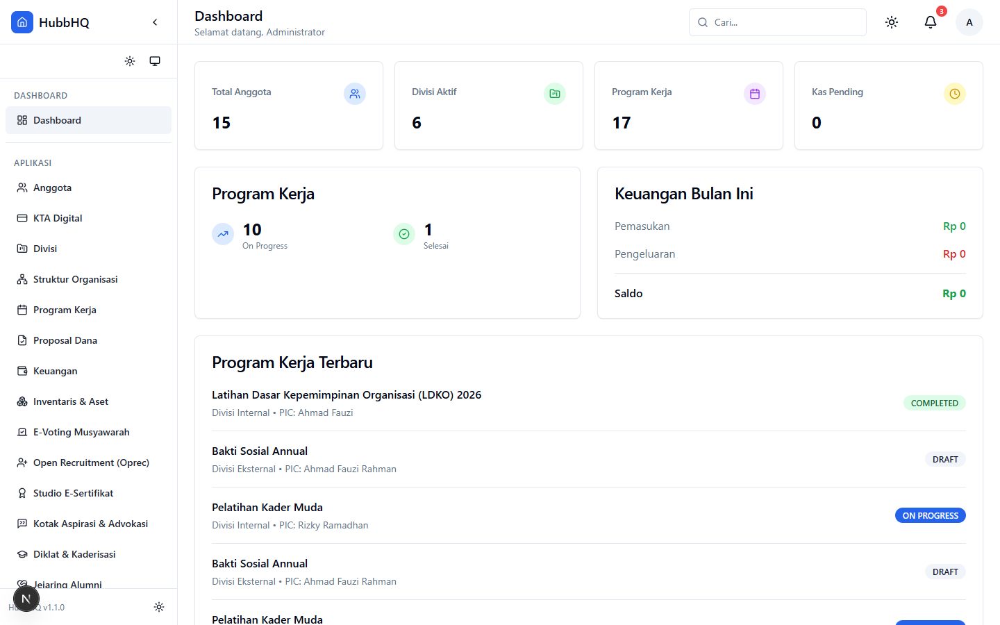 | 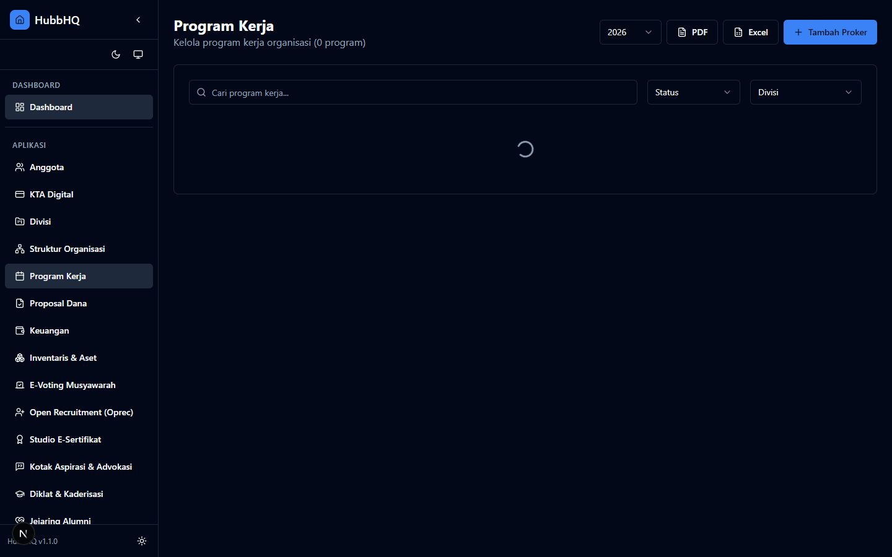 | 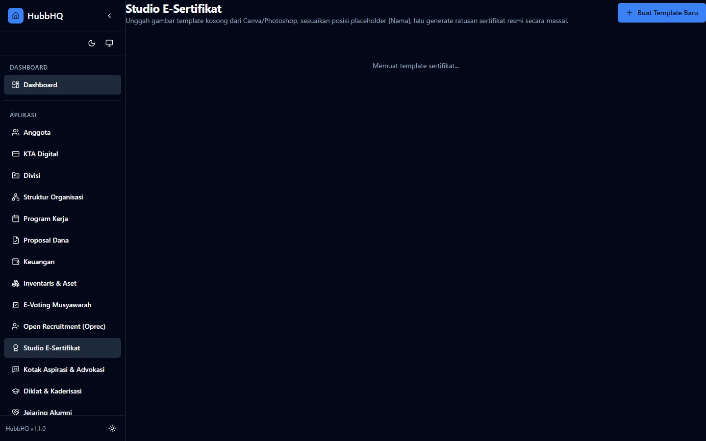 |

| Persuratan & Verifikasi QR | Keuangan & Kas Organisasi | Manajemen Anggota & KTA |
| :---: | :---: | :---: |
| 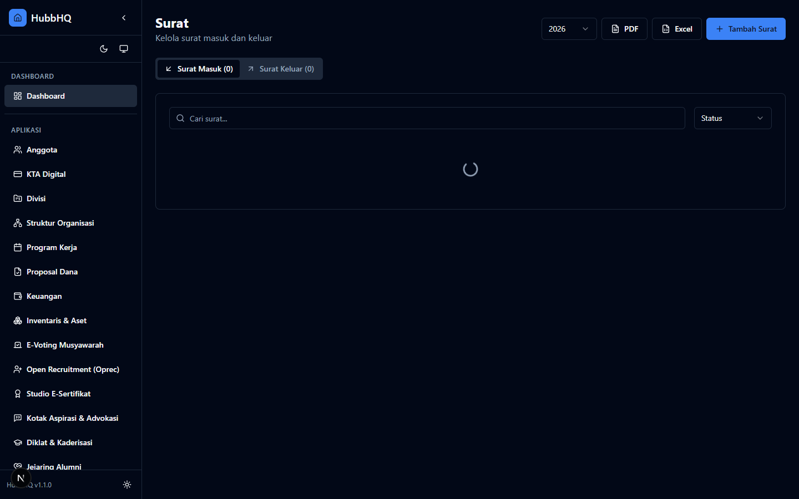 |  | 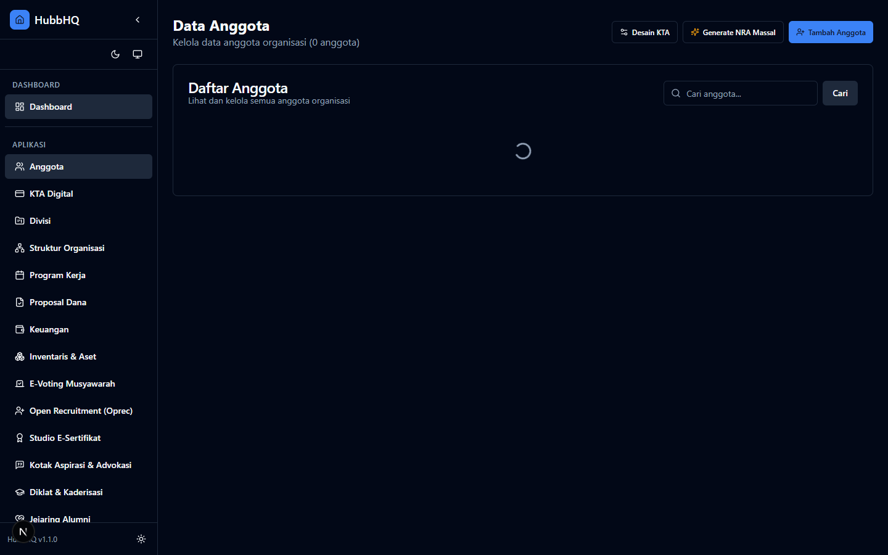 |

| Open Recruitment Terpadu | Portal Aspirasi & Advokasi | Kaderisasi & Jenjang Diklat |
| :---: | :---: | :---: |
| 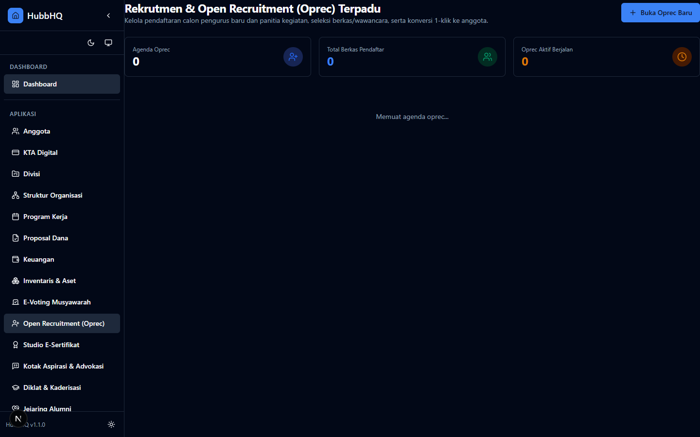 | 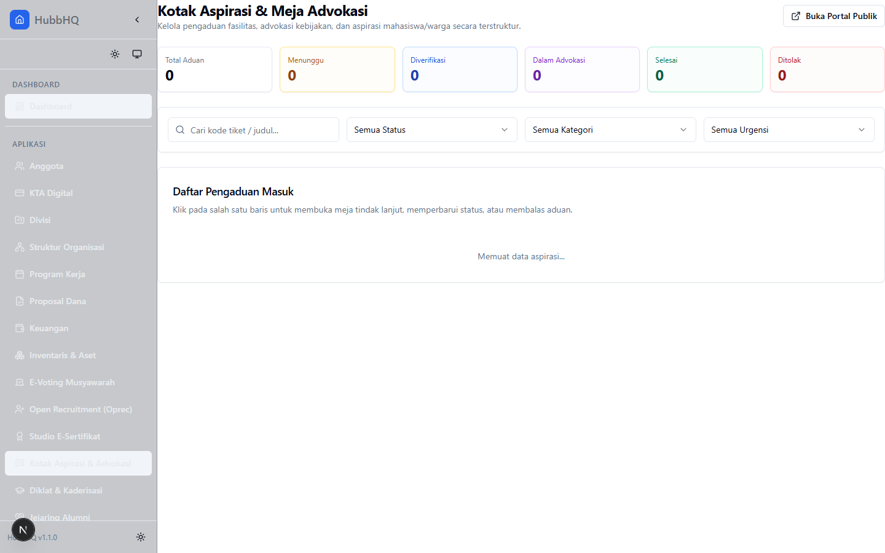 | 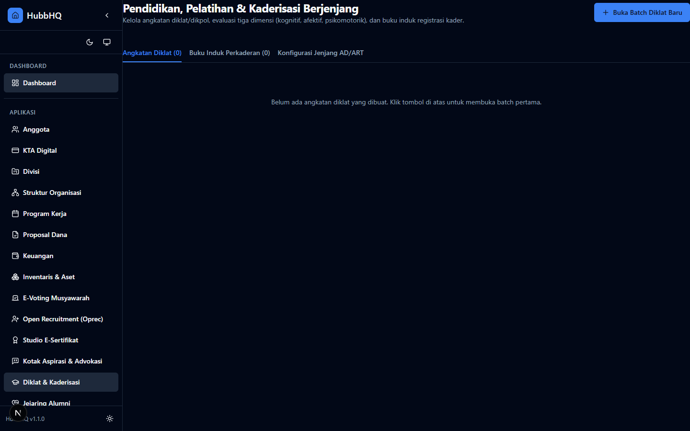 |

| Jaringan Alumni & Dana Abadi | Risalah Sidang Musyawarah & SK |
| :---: | :---: |
| 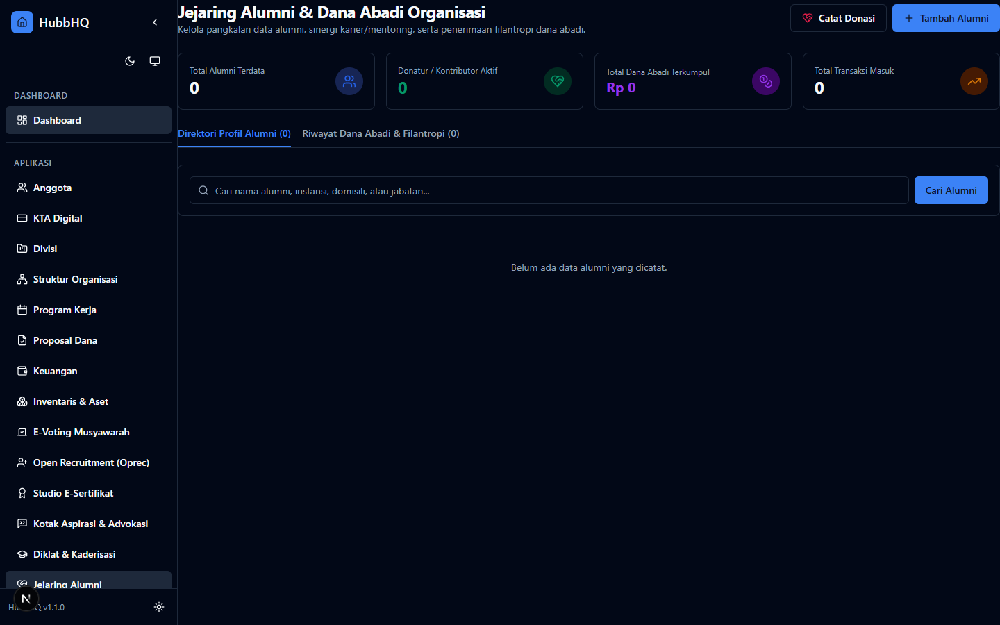 | 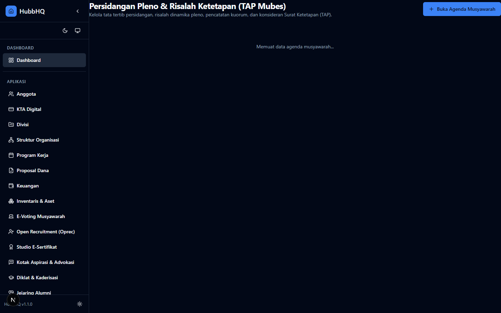 |

---

## Fitur Utama

- **Tata Kelola Program Kerja (Proker):** Halaman mandiri per-kegiatan, checkpoint tahapan progres (kontras tinggi di Dark Mode), penugasan PIC, dan struktur panitia pelaksana (OC).
- **Proposal Dana & Versioning (Git-Like):** Pengajuan anggaran berbasis PIC, review persetujuan/penolakan BPH, dan audit trail riwayat revisi proposal.
- **Sistem LPJ 3 Kantong Dana:** Pembagian pos dana riil (`DANA_AJUAN`, `KAS_PROKER`, `DANA_LUAR`), opsi fleksibel alokasi surplus sisa kas (auto-jurnal kas umum atau apresiasi panitia), checklist kelaikan berkas fisik pra-sidang, dan ekspor LPJ otomatis ke PDF/Excel.
- **Studio E-Sertifikat:** Desain visual canvas HD kustom (berbasis template blanko Canva/Photoshop), pemetaan koordinat dinamis `{Nama}`, `{Sebagai}`, `{Nomor}`, `{Tanggal}`, kode QR verifikasi publik, generate massal dari daftar nama, serta integrasi arsip langsung ke Object Storage (Cloudflare R2 / S3 / AList).
- **E-Sertifikat Kepanitiaan Proker:** Terintegrasi penuh dengan Studio E-Sertifikat, penomoran baku otomatis (`001/SERT-OC/...`), verifikasi keabsahan publik, dan unduh piagam beresolusi tinggi.
- **Open Recruitment (Oprec) Terpadu:** Portal pendaftaran publik ber-slug unik, pelacakan mandiri status seleksi calon anggota, manajemen verifikasi berkas & penilaian wawancara, serta konversi 1-klik pendaftar lulus menjadi anggota resmi.
- **Portal Advokasi & Aspirasi Berstatus:** Kotak saran dan aduan publik (opsi anonim/terdata), penerbitan nomor tiket unik ber-token verifikasi, serta pemantauan progres tindak lanjut oleh pengurus/BPH.
- **Kaderisasi & Jenjang Diklat/Dikpol:** Buku induk kaderisasi, pencatatan Nomor Registrasi Kader (NRK), jenjang kaderisasi berjenjang (Pra-Dasar, Dasar, Menengah, Lanjut), serta penerbitan STTPP/Sertifikat Kelulusan.
- **Pengelolaan Jaringan Alumni & Dana Abadi:** Direktori pangkalan data alumni lintas angkatan, pelacakan karier/afiliasi profesional, pencatatan kontribusi donasi dana abadi program organisasi, dan transparansi laporan kas alumni.
- **Risalah Persidangan Musyawarah & Konsideran SK:** Workbench sidang pleno/musyawarah (Musyang/Mubes/Raker), notulensi kronologis waktu nyata, dan generator Surat Keputusan (SK/TAP) berkonsideran lengkap (*Menimbang, Mengingat, Memperhatikan, Memutuskan*) siap cetak resmi ber-QR.
- **Persuratan & QR HMAC Verification:** Generator surat dinamis, penomoran otomatis, stempel tanda tangan, dan verifikasi keaslian surat via scan QR publik.
- **Keuangan & Iuran Kas Anggota:** Pencatatan kas masuk/keluar, approval bendahara, rekapitulasi saldo, dan ekspor laporan keuangan.
- **Kalender Kegiatan Organisasi:** Integrasi jadwal agenda dan timeline program kerja berbasis FullCalendar.
- **Website CMS Builder:** Pembuat portal publik dinamis berbasis drag-and-drop dengan tema modern.
- **Keamanan Berstandar Tinggi:** NextAuth v5, Role-Based Access Control (RBAC), perlindungan brute-force rate-limiting, dan integrasi spreadsheet aman via ExcelJS.

---

## Rekomendasi Spesifikasi Server & Hosting

Agar HubbHQ berjalan lancar, cepat, dan tidak mengalami penurunan performa atau server mogok (*crash / Out of Memory*), berikut adalah panduan kapasitas server:

### Tabel Kebutuhan Hardware

| Kategori | Spesifikasi Minimal Server | Estimasi Beban Pengguna | Rekomendasi Provider |
| :--- | :--- | :--- | :--- |
| **Tier 1: Minimal (Starter / Budget Hemat)** | • **2 vCPU**<br>• **2 GB RAM** (+ Wajib 2 GB Swap)<br>• **25 GB SSD / NVMe** | 1 organisasi kecil (20–100 anggota), 10–25 pengguna aktif bersamaan (*concurrent*). | DigitalOcean Basic, Hetzner CX22, atau VPS Lokal (Biznet GIO / IDCloudHost / DomaiNesia). |
| **Tier 2: Standar Rekomendasi (Sweet Spot Menengah)** | • **2–4 vCPU**<br>• **4 GB RAM** (+ 2 GB Swap)<br>• **50 GB NVMe Storage** | BEM Fakultas, Ormawa Kampus, Karang Taruna, OKP (100–500 anggota). Aman saat rapat serentak atau ekspor dokumen massal. | Hetzner CPX31, DigitalOcean Standard, Contabo Cloud VPS S. |
| **Tier 3: Skala Besar / Institusi (Kampus / Nasional)** | • **4–8 vCPU**<br>• **8 GB–16 GB RAM**<br>• **Managed MySQL Terpisah** | Ormawa Universitas, Organisasi Kemasyarakatan Nasional (>1.000 anggota, ribuan berkas arsip). | AWS EC2 / Lightsail, Google Cloud Compute Engine, atau Alibaba Cloud. |

### Praktik Konfigurasi Wajib agar Tidak Lambat & Patah-patah:

1. **Aktifkan Swap Memory (Minimal 2 GB - 4 GB):**
   Pada VPS Linux, swap bertindak sebagai bantalan ketika pemrosesan PDF/Excel memuncak sehingga server tidak mati mendadak akibat *OOM Killer*.
2. **Gunakan Next.js Standalone Build di Docker:**
   Gunakan mode `output: 'standalone'` pada `next.config.js` untuk memangkas ukuran container dan menghemat pemakaian memori server.
3. **Optimasi Buffer Pool MySQL (`my.cnf`):**
   Atur `innodb_buffer_pool_size` sesuai kapasitas RAM (misal 512MB pada server 2GB, atau 1.5GB pada server 4GB) agar pembacaan relasi data proker dan keuangan langsung dari cache RAM.
4. **Nginx Caching untuk Aset Statis:**
   Pastikan reverse proxy Nginx meng-cache folder `/_next/static/` dan file gambar publik dengan `Cache-Control: public, max-age=31536000, immutable`.
5. **Gunakan Object Storage untuk Berkas Upload:**
   Untuk bukti transfer, proposal, dan nota fisik, sambungkan ke cloud storage S3-compatible seperti Cloudflare R2 (gratis 10GB dan tanpa biaya egress bandwidth) atau AWS S3/MinIO/AList agar disk server tidak cepat penuh.

---

## Panduan Instalasi Cepat (Quick Start)

### Opsi 1: Menggunakan Docker Compose (Direkomendasikan)

```bash
# 1. Clone repository
git clone https://github.com/ibnuasyi/HubbHQ.git
cd HubbHQ

# 2. Siapkan file environment
cp .env.example .env

# 3. Jalankan container di background
docker-compose up -d

# 4. Buka browser di http://localhost:3000/setup
```

### Opsi 2: Instalasi Manual

```bash
# 1. Install dependencies
npm install

# 2. Konfigurasi environment
cp .env.example .env

# 3. Sinkronisasi database
npm run db:generate
npm run db:push
npm run db:seed

# 4. Jalankan development server
npm run dev
```

Buka [http://localhost:3000](http://localhost:3000) di peramban Anda.

---

## Akun Bawaan (Default Credentials)

Setelah menjalankan `npm run db:seed`, Anda dapat masuk menggunakan akun default berikut:

| Peran (Role) | Email | Password | Hak Akses |
| :--- | :--- | :--- | :--- |
| **Administrator** | `admin@siop.local` | `admin123` | Akses penuh ke seluruh konfigurasi, master data, dan modul sistem |
| **Anggota** | `ahmad@siop.local` | `password123` | Akses dashboard anggota, profil, dan agenda kegiatan |

---

## Arsitektur Sistem

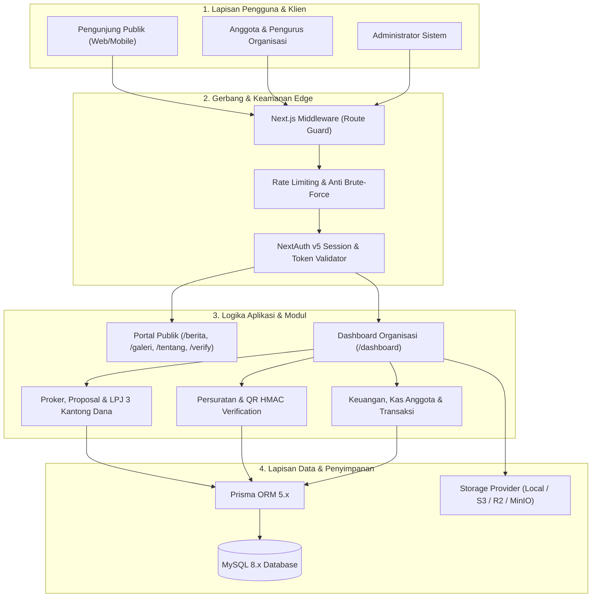

---

## Roadmap & Perubahan

- [ROADMAP.md](ROADMAP.md) - Rencana pengembangan fitur organisasi selanjutnya (Presensi QR, KTA Digital, Inventaris Logistik, E-Voting PEMIRA, Kas QRIS).
- [CHANGELOG.md](CHANGELOG.md) - Riwayat pembaruan dan rilis versi.

---

## Lisensi & Kontribusi

Project ini dilisensikan di bawah **GNU Affero General Public License v3.0 (AGPL-3.0)**.
Silakan baca [LICENSE](LICENSE) dan [CONTRIBUTING.md](CONTRIBUTING.md) untuk panduan berkontribusi.

<p align="center">
  Dikembangkan dengan dedikasi untuk kemajuan organisasi di Indonesia oleh <strong>Ibnu Batuthah</strong>
</p>
